# Содержание
# [1. Установка с нуля](#p1)
## [1.1 Linux](#p11)
## [1.2 Windows](#p12)
# [2. Старт с нуля (с базой данных в начальном состоянии)](#p2)
## [2.1 Старт с нуля - инициализация](#p21)
### [2.1.1 Касательно проекта](#p211)
### [2.1.2 Инициализация базы данных](#p212)
#### [1) Инициализация через веб-интерфейс](#p2121)
#### [2) Инициализация через терминал (если размер файла бэкапа слишком большой)](#p2122)
## [2.2 Старт с нуля – сброс (возвращение к исходному состоянию)](#p22)
### [2.2.1 Полная последовательность сброса](#p221) 
# [3. Запуск подготовленной версии (режим продолжения работы после предыдущей запущенной сессии)](#p3)
# [4. Создание резервной копии базы данных (Бэкап). Экспорт](#p4)
## [1) Через веб-интерфейс](#p41)
## [2) Через терминал](#p42)
# [5. Описание docker-compose.yml](#yml_info)


<a id="p1"></a>
# 1. Установка с нуля
<a id="p11"></a>
## 1.1 Linux
Выполнить в терминале
---
1) Скопировать – вставить:

```
sudo apt-get update
sudo apt-get install ca-certificates curl
sudo install -m 0755 -d /etc/apt/keyrings
sudo curl -fsSL https://download.docker.com/linux/ubuntu/gpg -o /etc/apt/keyrings/docker.asc
sudo chmod a+r /etc/apt/keyrings/docker.asc

echo \
  "deb [arch=$(dpkg --print-architecture) signed-by=/etc/apt/keyrings/docker.asc] https://download.docker.com/linux/ubuntu \
  $(. /etc/os-release && echo "${UBUNTU_CODENAME:-$VERSION_CODENAME}") stable" | \
  sudo tee /etc/apt/sources.list.d/docker.list > /dev/null
sudo apt-get update
```

---
2) Скопировать – вставить:
```
sudo apt-get install docker-ce docker-ce-cli containerd.io docker-buildx-plugin docker-compose-plugin
```
---

3) НЕОБЯЗАТЕЛЬНО (Проверка, что установка прошла успешно)

``` 
docker run hello-world
```

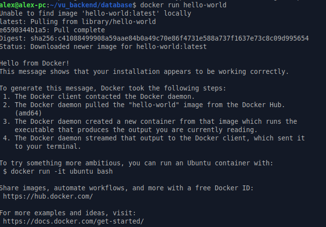

---
4) Докер может не работать без судо, ниже представлено решение

   1. Добавляем текущего пользователя в группу Docker  
     ```
     sudo usermod -aG docker $USER
     ```
   2. Перезапускаем систему
   3. Применяем изменения группы
     ```
     newgrp docker
     ```
   4. Перезапускаем систему
-------------------------------------------------------------
<a id="p12"></a>
## 1.2 Windows

Переходим на сайт

https://docs.docker.com/desktop/setup/install/windows-install/


Выбираем Docker Desktop for Windows x86_64, скачиваем, запускаем экзешник .exe и следуем инструкциям указанным в установочнике

---
<a id="p2"></a>
# 2. Старт с нуля (с базой данных в начальном состоянии)
<a id="p21"></a>
## 2.1 Старт с нуля - инициализация

Для развертки докера с подготовленными образами(images) и .yml документом используется команда

```
docker compose up -d
```

Чтобы прекратить работу(завершить текущую сессию) используется команда

```
docker compose down
```
<a id="p211"></a>
### 2.1.1 Касательно проекта  
[```docker-compose.yml```](#yml_info) и образы  находятся в папке ```vu_backend/database/```
Для того, чтобы развенуть базу данных необходимо в папке ```database``` открыть терминал
и ввести команду ```docker compose up -d```

После ввода команды запустится 2 контейнера:
1. с базой данных
2. с веб-интерфейсом для администрирования базы данных
 
В консоли должно отобразиться следующее


Если после разверки ввести команду ```docker ps```
Должно отобразится	 следующее

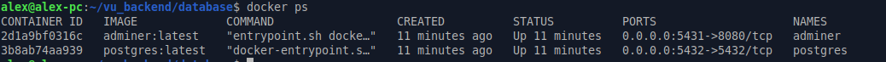
<a id="p212"></a>
### 2.1.2 Инициализация базы данных
<a id="p2121"></a>
#### 1) Инициализация через веб-интерфейс

Чтобы инициализировать базу данных необходимо перейти в браузер
прописать ```localhost:5431```  (порт ```5431``` указан в [```docker-compose.yml```](#yml_info) (пункт [```ports```](#yml_info_adminer_ports)), если необходим другой, то там можно поменять (до развертки или после завершения сессии))


После откроется веб-интерфейс ```adminer```, где необходимо будет пройти авторизацию, указав данные, прописанные в [```docker-compose.yml```](#yml_info) (пункт [```enviroment```](#yml_info_postgres_env)), можно поменять при желании), после чего нажать на кнопку ```login```.

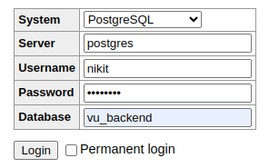

Заполнение полей на примере [```docker-compose.yml```](#yml_info)
```
System: PostgreSQL
Server: postgres
Username: nikit
Password: admin000
Database: vu_backend
```
вырезка из [```docker-compose.yml```](#yml_info) (пункт [```enviroment```](#yml_info_postgres_env))
```
      POSTGRES_USER: nikit              //имя пользователя базы данных (можно установить желаемое) используется для входа в веб-интерфейс (adminer)
      POSTGRES_PASSWORD: admin000       //пароль пользователя базы данных (можно установить желаемый) используется для входа в веб-интерфейс (adminer)
      POSTGRES_DB: vu_backend           //название базы данных
```

После авторизации появится окно с интерфейсом для управления базой данных,Чтобы импортировать базу данных, необохдимо нажать на кнопку ```Import```

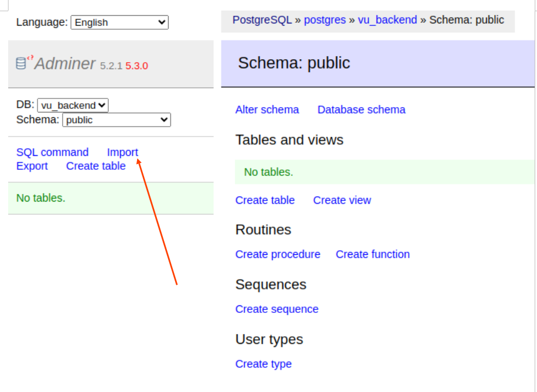

После нажатия на ```Import```, появится следующее меню, где нужно нажать на кнопку ```Choose Files```, после чего выбрать файл ```init_db.sql``` или любой другой ```бэкап_файл.sql``` и нажать на кнопку ```Execute```

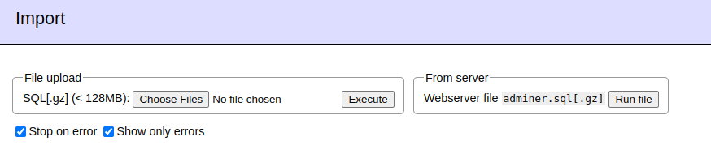


При успешной инициализации слева появится список таблиц и представлений

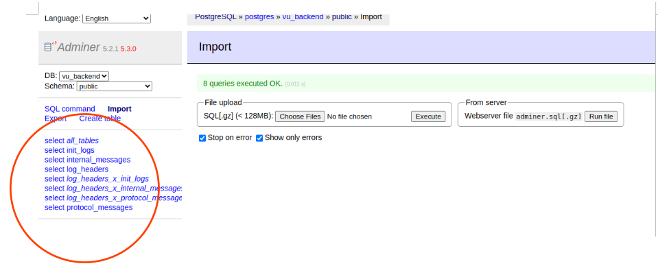

<a id="p2122"></a>
#### 2) Инициализация через терминал (если размер файла бэкапа слишком большой)

Используется как альтернативный способ инициализации, либо **когда размер файла слишком большой** для импорта через интерфейс

```
docker exec -i имя_контейнера  psql -U имя_пользоватя  имя_базы_данных < файл_с_инициализацией_базы_данных.sql
```
***имя*** контейнера, пользователя и базы данных берется из [```docker-compose.yml```](#yml_info) (пункт [```enviroment```](#yml_info_postgres_env))


```
container_name: postgres
      POSTGRES_USER: nikit              //имя пользователя базы данных (можно установить желаемое) используется для входа в веб-интерфейс (adminer)
      POSTGRES_DB: vu_backend           //название базы данных

```

**Таким образом в нашем случае получается**
```
docker exec -i postgres  psql -U nikit  vu_backend < init_db.sql
```

<a id="p22"></a>
## 2.2 Старт с нуля – сброс (возвращение к исходному состоянию)

Чтобы работать с неизмененной(исходной) базой данных в предудущей сессии, необходимо удалить том c помощью команды

```
docker volume rm название_тома
```

Чтобы узнать название тома, можно просмотреть список томов с помощью команды

```docker volume ls```

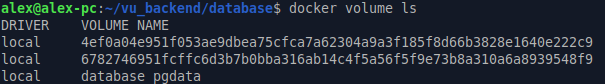

Если не менять название тома в [```docker-compose.yml```](#yml_info), то в названии будет присутствовать **pgdata**

Если делать развертку из папки ```database```, то вероятнее всего имя будет – ```database_pgdata```, но лучше убедиться с помощью команды ```docker volume ls```

<a id="p221"></a>
### Полная последовательность сброса 
Выглядит следующим образом:
1) Прекратить текущую сессию если она запущена
```
docker compose down
```
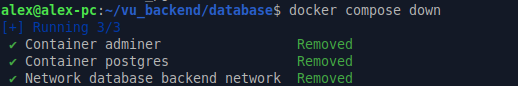

2) Посмотреть название тома
```
docker volume ls
```
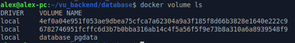

В нашем случае название тома: ```database_pgdata```

3) Удалить том

```
docker volume rm database_pgdata
```
после выполнения команды снизу отобразится название удаленного тома

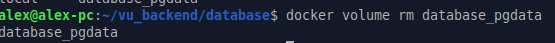

4) Запустить сессиию

```
docker compose up -d
```


5) Инициализировать базу данных как в пункте 2.1

*Примечание: после удаления тома, запуск сессии становится всегда аналогичным пункту 2.1. 
При выполнении пункта 2.1 имя тома также можно узнать из этих строчек в терминале, отображается напротив пункта Volume.*

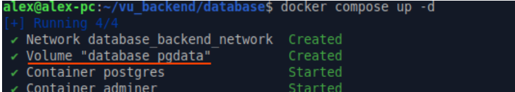

<a id="p3"></a>
# 3. Запуск подготовленной версии (режим продолжения работы после предыдущей запущенной сессии)

После инициализации база данных будет сохранена в томе, который будет храниться в докере, благодаря чему работу контейнеров можно будет прекратить и запустить когда понадобиться, не теряя состояния базы данных. 
Соответственно чтобы продолжить работать с базой данных в состоянии предыдущей сессии достачно выполнить команду в терминале в папке ```database```, аналогично с пунктом 2.1

```
docker compose up -d
```

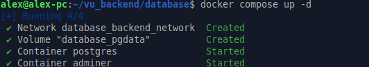

<a id="p4"></a>
# 4. Создание резервной копии базы данных (Бэкап). Экспорт
<a id="p41"></a>
## 1) Через веб-интерфейс

Нажать на кнопку ```Export```

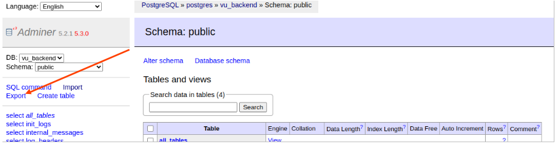

Появится меню, где нужно выбрать следующии пункты

```
output – save
format – sql
database: drop + create, +user types, +Routines
tables: drop + create, +auto increment, +Triggers
data: truncate + insert
```

На скриншоте ниже отмечены все нужные пункты. После нажать на кнопку ```Export``` и либо откроется окно, где нужно будет указать куда сохранить файл(желательно в ```vu_bakcend/database```), либо файл автоматически скачается в директорию по умолчанию, тогда нужно будет перенести его в ```vu_backend/database```

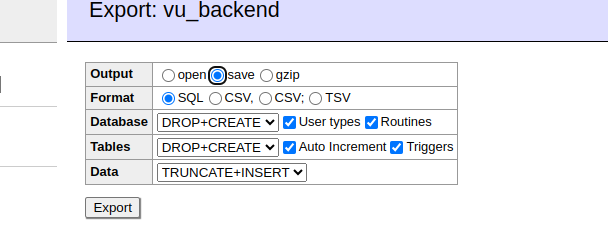

<a id="p42"></a>
## 2) Через терминал

```
docker exec -t имя_контейнера  pg_dump -c -U имя_пользователя имя_базы_данных  > название_выходного_файла_бэкапа.sql
```

**имя** контейнера, пользователя и базы данных берется из [```docker-compose.yml```](#yml_info) (пункт [```enviroment```](#yml_info_postgres_env))

```
container_name: postgres
      POSTGRES_USER: nikit              //имя пользователя базы данных (можно установить желаемое) используется для входа в веб-интерфейс (adminer)
      POSTGRES_DB: vu_backend           //название базы данных
```

Таким образом в нашем случае получается

```
docker exec -t postgres  pg_dump -c -U nikit vu_backend  > backup.sql
```

<a id="yml_info"></a>
# 5. Описание docker-compose.yml
"//" - обозначение комментария


```
services:                               //перечисление сервисов для развертки
```
```
  postgres:                             //имя сервиса с базой данных (нет смысла изменять)
```
```
    image: postgres:latest              //образ с базой данных (не изменять)
```
```  
    container_name: postgres            //имя контейнера (нет смысла изменять)
```
<a id="yml_info_postgres_env"></a>
```
    environment:                        //описание переменных среды (базы данных). 
                                        //(переменные среды можно изменить, при необходимости)

      POSTGRES_USER: nikit              //имя пользователя базы данных 
                                        //используется для входа в веб-интерфейс (adminer)

      POSTGRES_PASSWORD: admin000       //пароль пользователя базы данных 
                                        //используется для входа в веб-интерфейс (adminer)

      POSTGRES_DB: vu_backend           //название базы данных
```
```
    volumes:                            //список томов (не изменять)
                                        //тома создаются во внешнем пункте volumes

      - pgdata:/var/lib/postgresql/data //связь тома с хранилищем
```
```
    ports:                              //порты сервиса postgres, 
                                        //нужны для доступа к базе данных
                                        //(оба можно изменить, при необходимости)
                                        //слева внешний порт(вне докера), 
                                        //справа порт на который будет 
                                        //перебрасываться запрос от внешнего

      - "5432:5432"                     //соединение внешнего и внутренного портов
```
```
    networks:                           //перечисление сетей сервиса
    
      - backend_network                 //имя внутренней сети, в которой 
                                        //общаются сервисы докера
                                        //(сеть создается во внешнем пункте networks)
```
```
  adminer:                              //имя сервиса с веб-интерейсом
                                        //для администрирования базы данных (нет смысла изменять)
``` 
```
    image: adminer:latest               //образ с веб-интерфейсом для администрирования 
                                        //базы данных (не изменять)
```
```
    container_name: adminer             //имя контейнера (нет смысла изменять)
```
<a id="yml_info_adminer_ports"></a>

```    
    ports:                              //порты сервиса adminer, 
                                        //нужны для доступа к веб-интерфейсу
                                        //(оба можно изменить, при необходимости) 
                                        //cлева внешний порт(вне докера), 
                                        //справа порт на который будет 
                                        //перебрасываться запрос от внешнего
                                        //во внешнем порту(слева) указывается число, которое 
                                        //нужно будет также указать после 
                                        //localhost:левый порт,
                                        //в нашем случае, для доступа к веб-интерфейсу
                                        //необходимо будет в браузере набрать 
                                        //localhost:5431                                        

      - "5431:8080"                     //соединение портов
```
```
    depends_on:                         //описание зависимостей сервисов друг от друга
                                        //(сервис в котором перечислены зависимости 
                                        //не запустится раньше, чем те сервисы, 
                                        //которые указаны в зависимостях)

      - postgres                        //имя сервиса от которого зависит запуск, в нашем 
                                        //случае запуск adminer зависит от postgres
```

```
    networks:                           //перечисление сетей

      - backend_network                 //имя внутренней сети 
                                        // в которой общаются сервисы докера
                                        //(сеть создается во внешнем пункте networks)
```
```
volumes:                                //внешний пункт volumes
                                        //перечисление томов для создания 
                                        //имена указываются перед двоеточием

  pgdata:                               //имя тома (в этом томе будет хранится база данных)
```
```
networks:                               //внешний пункт, в котором перечисляются сети, 
                                        //которые будут созданы в докере

  backend_network:                      //название сети (лучше не изменять)
                                        //если изменить название 
                                        //(указывается слева(перед двоеточием)), 
                                        //то необходимо поменять название и в связанных с ней 
                                        //сервисах в пунктах networks

    driver: bridge                      //указание того, что сеть является мостом (не изменять)
```