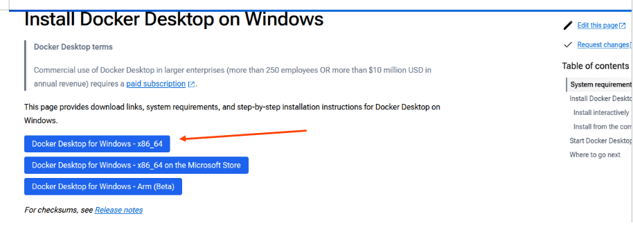
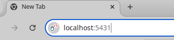
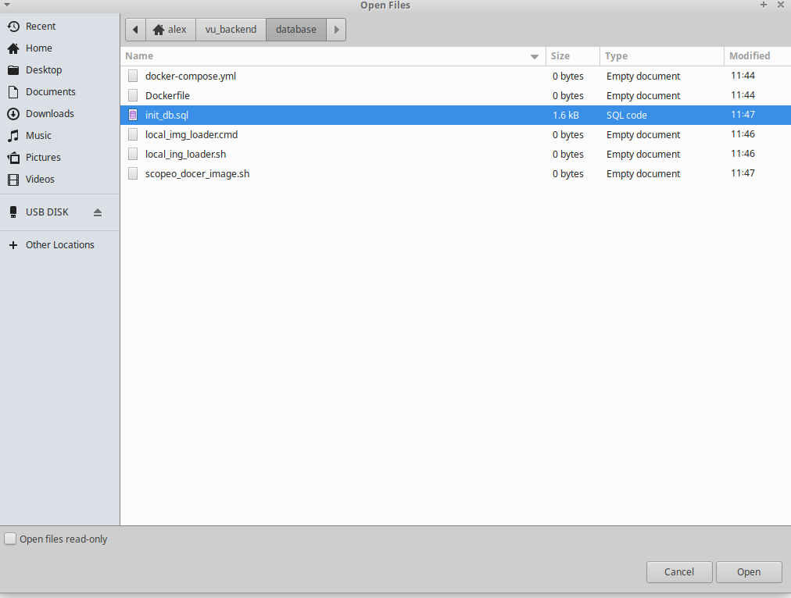
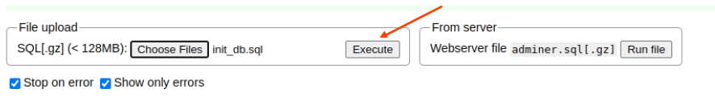

# Документация по работе с Docker

---

## Содержание
- [Документация по работе с Docker](#документация-по-работе-с-docker)
	- [Содержание](#содержание)
- [1. Установка с нуля](#1-установка-с-нуля)
	- [1.1 Linux](#11-linux)
	- [1.2 Windows](#12-windows)
- [2. Старт с нуля (с базой данных в начальном состоянии)](#2-старт-с-нуля-с-базой-данных-в-начальном-состоянии)
	- [2.1 Инициализация](#21-инициализация)
		- [2.1.1 Касательно проекта](#211-касательно-проекта)
		- [2.1.2 Инициализация базы данных](#212-инициализация-базы-данных)
			- [1) Через веб-интерфейс](#1-через-веб-интерфейс)
			- [2) Через терминал (если файл бэкапа слишком большой)](#2-через-терминал-если-файл-бэкапа-слишком-большой)
	- [2.2 Сброс к исходному состоянию](#22-сброс-к-исходному-состоянию)
		- [Полная последовательность сброса](#полная-последовательность-сброса)
- [3. Запуск подготовленной версии](#3-запуск-подготовленной-версии)
- [4. Создание резервной копии базы данных (Бэкап)](#4-создание-резервной-копии-базы-данных-бэкап)
	- [1) Через веб-интерфейс](#1-через-веб-интерфейс-1)
	- [2) Через терминал](#2-через-терминал)
- [5. Описание docker-compose.yml](#5-описание-docker-composeyml)

---

<a id="1"></a>
# 1. Установка с нуля

<a id="1.1"></a>
## 1.1 Linux

Выполните в терминале:

```bash
sudo apt-get update
sudo apt-get install ca-certificates curl
sudo install -m 0755 -d /etc/apt/keyrings
sudo curl -fsSL https://download.docker.com/linux/ubuntu/gpg -o /etc/apt/keyrings/docker.asc
sudo chmod a+r /etc/apt/keyrings/docker.asc

echo \
  "deb [arch=$(dpkg --print-architecture) signed-by=/etc/apt/keyrings/docker.asc] https://download.docker.com/linux/ubuntu \
  $(. /etc/os-release && echo \"${UBUNTU_CODENAME:-$VERSION_CODENAME}\") stable" | \
  sudo tee /etc/apt/sources.list.d/docker.list > /dev/null
sudo apt-get update
```

```bash
sudo apt-get install docker-ce docker-ce-cli containerd.io docker-buildx-plugin docker-compose-plugin
```

**Проверка установки:**
```bash
docker run hello-world
```


**Docker без sudo:**
1. Добавьте пользователя в группу Docker:
   ```bash
   sudo usermod -aG docker $USER
   ```
2. Перезапустите систему.
3. Примените изменения группы:
   ```bash
   newgrp docker
   ```
4. Перезапустите систему ещё раз.

## Альтернативный вариант для Astra Linux 1.7

- установить docker через apt
    ```bash
    sudo apt update && sudo apt install docker.io
    ```
- если нужно развернуть всю архитектуру единой командой, установить docker-compose
    ```bash
    sudo apt install docker-compose
    ```
- добавить пользователя в группу docker
  ```bash
  sudo usermod -aG docker $USER
  ```
- Перелогиниться из сессии/ssh-подключения


<a id="1.2"></a>
## 1.2 Windows

Перейдите на сайт:
[https://docs.docker.com/desktop/setup/install/windows-install/](https://docs.docker.com/desktop/setup/install/windows-install/)



Скачайте Docker Desktop for Windows x86_64, запустите .exe и следуйте инструкциям установщика.

---

<a id="2"></a>
# 2. Старт с нуля (с базой данных в начальном состоянии)

<a id="2.1"></a>
## 2.1 Инициализация

Для развертки Docker с подготовленными образами и .yml используйте:

```bash
docker compose up -d
```

Остановить работу (завершить сессию):
```bash
docker compose down
```

<a id="2.1.1"></a>
### 2.1.1 Касательно проекта

Файлы `docker-compose.yml` и образы находятся в папке `vu_backend/database/`. Откройте терминал в папке `database` и выполните:

```bash
docker compose up -d
```

После запуска появятся 2 контейнера: база данных и веб-интерфейс для администрирования.


Проверьте контейнеры:
```bash
docker ps
```


<a id="2.1.2"></a>
### 2.1.2 Инициализация базы данных

<a id="2.1.2.1"></a>
#### 1) Через веб-интерфейс

Перейдите в браузере на `localhost:5431` (порт указан в `docker-compose.yml`).



Войдите, используя данные из `docker-compose.yml`:
```
System: PostgreSQL
Server: postgres
Username: nikit
Password: admin000
Database: vu_backend
```


После авторизации нажмите `Import`, выберите файл `init_db.sql` или другой бэкап и нажмите `Execute`.





При успехе слева появится список таблиц и представлений.


<a id="2.1.2.2"></a>
#### 2) Через терминал (если файл бэкапа слишком большой)

```bash
docker exec -i postgres  psql -U nikit  vu_backend < init_db.sql
```

---

<a id="2.2"></a>
## 2.2 Сброс к исходному состоянию

Чтобы вернуть базу к исходному состоянию, удалите том:

```bash
docker volume ls
# Найдите имя, например: database_pgdata
docker volume rm database_pgdata
```

<a id="2.2.1"></a>
### Полная последовательность сброса
1. Остановите сессию:
   ```bash
   docker compose down
   ```
2. Посмотрите название тома:
   ```bash
   docker volume ls
   ```
3. Удалите том:
   ```bash
   docker volume rm database_pgdata
   ```
4. Запустите сессию:
   ```bash
   docker compose up -d
   ```
5. Инициализируйте базу данных как в пункте 2.1.

---

<a id="3"></a>
# 3. Запуск подготовленной версии

После инициализации база сохраняется в томе. Для продолжения работы используйте:

```bash
docker compose up -d
```


---

<a id="4"></a>
# 4. Создание резервной копии базы данных (Бэкап)

<a id="4.1"></a>
## 1) Через веб-интерфейс

Нажмите `Export`.


Выберите:
- output – save
- format – sql
- database: drop + create, +user types, +Routines
- tables: drop + create, +auto increment, +Triggers
- data: truncate + insert


<a id="4.2"></a>
## 2) Через терминал

```bash
docker exec -t postgres  pg_dump -c -U nikit vu_backend  > backup.sql
```

---

<a id="5"></a>
# 5. Описание docker-compose.yml

`//` — обозначение комментария

```yaml
services:                               // перечисление сервисов для развертки
  postgres:                             // имя сервиса с базой данных
    image: postgres:latest              // образ с базой данных
    container_name: postgres            // имя контейнера
    environment:                        // переменные среды
      POSTGRES_USER: nikit              // имя пользователя
      POSTGRES_PASSWORD: admin000       // пароль
      POSTGRES_DB: vu_backend           // название базы данных
    volumes:
      - pgdata:/var/lib/postgresql/data // связь тома с хранилищем
    ports:
      - "5432:5432"                     // внешний:внутренний порт
    networks:
      - backend_network                 // имя внутренней сети

  adminer:                              // сервис с веб-интерфейсом
    image: adminer:latest
    container_name: adminer
    ports:
      - "5431:8080"                     // внешний:внутренний порт
    depends_on:
      - postgres
    networks:
      - backend_network

volumes:
  pgdata:                               // том для хранения базы данных

networks:
  backend_network:
    driver: bridge                      // сеть типа bridge
```

---